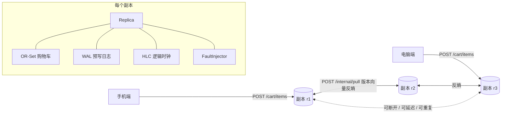

# 并行与分布式计算 · 购物车服务与网络分区

> 场景 1：**购物车服务在网络分区时仍允许修改购物车**。同一个用户可能同时用手机和电脑，
> 不能简单地用"最后写入者胜"覆盖掉其中一端添加的商品。
>
> 关键词：**CRDT、版本向量、冲突合并**

用 Python + asyncio + FastAPI 实现的一个可注入故障的购物车副本集群：
分区期间两端都能写，恢复后自动合并，并发添加不丢失，消息重复/乱序不影响最终结果；
下单结算则走另一条 CP 路径（主副本 + 多数派 + CAS），用来对比"为什么不能什么都用 CRDT"。

自带一个**可视化控制台**：三个副本的实时状态、链路开关、故障注入、加购与结算都是点按钮，
断网后能亲眼看到两边分叉、恢复后自动合并。

**GitHub 仓库**：`<在这里填仓库地址>`

---

## 看这里：可视化控制台

```powershell
python scripts/local.py start        # 起 r1/r2/r3 + 控制台
```

浏览器打开 **http://127.0.0.1:8010**

页面上能做的事：

| 区域 | 操作 | 能看到什么 |
|---|---|---|
| 三张副本卡片 | 加购 / 宕机 / 恢复 / **重启** / 写检查点 | 每个副本的购物车、`ops`、版本向量、当前故障；重启会显示从 WAL 恢复了多少条 |
| 网络链路 | 点「断开」/「恢复」 | 链路变红；两个分区各自演化 |
| 故障注入 | 延迟、重复份数、丢包率、**乱序窗口**、**响应丢失率** | 注入后 ops 不再同步、收敛变慢；响应丢失会触发自动重试 |
| 实验工具 | **清空节点 / 迁移 N 页后中断 / 继续迁移 / 时钟倒退 / 热点压测** | 覆盖 ④⑤⑥⑧ 四个 topic，全部可点 |
| 客户端 | 加购、删除、结算、并发抢单 | 结算自动路由到主副本；抢单用旧版本号 → 409 |
| 顶部徽章 | — | `副本一致`(绿) / `副本分歧`(黄)，随状态实时切换 |
| 事件面板 | — | 自动记录"出现分歧""已收敛""宕机""分区"等事件 |

卡片底部还会出现一行**红字**：`若按时间戳覆盖 → 苹果×2`。那是同一批操作走 LWW
会得到的结果——用来直观说明"为什么不能用时间戳覆盖"。

推荐演示顺序：**断开 r3 的链路 → r1 加"咖啡豆"、r3 加"燕麦奶" → 看两边分叉 →
恢复链路 → 看自动合并成并集**。整个过程 5 秒内完成，非常适合录屏。

控制台是一个**独立进程**，所以把任意副本（包括它挂载的那台）按宕机，页面都不会消失。

---

## 30 秒上手（不需要 Docker）

```powershell
uv venv .venv --python 3.13
uv pip install --python .venv\Scripts\python.exe pytest hypothesis fastapi uvicorn httpx pytest-asyncio

$env:PYTHONPATH = "src"
.\.venv\Scripts\python.exe -m cart.runner      # 跑完 9 个故障场景，输出 PASS/FAIL 对照表
.\.venv\Scripts\python.exe -m pytest -q        # 68 个测试
```

> 也可以 `uv pip install --python .venv\Scripts\python.exe -e ".[dev]"` 装成可编辑包，
> 效果一样（依赖写在 `pyproject.toml` 里）；上面这行不依赖构建后端，最稳。

`cart.runner` 会逐个打印「预测 → 注入 → 对照 → 解释」，最后给一张总览表：

```
编号  场景                          检查   耗时     结果
1     一个副本突然宕机              3/3    ~0ms    PASS
2     双向分区，消息被重复发送三次  4/4    ~0ms    PASS
...
场景通过 9/9
```

---

## 四条运行路径

| 路径 | 命令 | 用途 |
|---|---|---|
| **可视化控制台**（最直观） | `python scripts/local.py start` → 打开 http://127.0.0.1:8010 | 点按钮演示分区、注入故障、看收敛 |
| **进程内场景**（最确定） | `python -m cart.runner` | 9 个故障场景，秒级，确定性最好 |
| **本地三进程 HTTP** | `python scripts/local.py start` → `python scripts/demo_http.py` | 真实 TCP + 真实反熵循环 |
| **Docker 编排** | `docker compose up --build -d` → http://127.0.0.1:8010 | 三容器三数据卷，最接近部署形态 |

四条路径共用同一套 CRDT、WAL 与故障注入代码，结论一致。

```powershell
# 本地：三个副本 + 控制台
python scripts/local.py start
#   控制台      http://127.0.0.1:8010
#   r1/r2/r3    http://127.0.0.1:8001-8003  （/docs 有自动生成的接口文档）

python scripts/demo_http.py        # 无界面的端到端脚本，10/10 通过
python scripts/local.py stop

# Docker（需要 Docker Desktop 已启动）
docker compose up --build -d       # 控制台 http://127.0.0.1:8010
docker compose down -v
```

---

## 它到底演示了什么

**1. 分区期间两端都能写，且谁也不覆盖谁**

手机连 r1 加"咖啡豆×2"，电脑连 r3 加"燕麦奶×1"，中间断网。恢复后：

```
r1 = r2 = r3 = {咖啡豆: 2, 燕麦奶: 1, 苹果: 3}
```

同款商品两端各加（1 和 2）得到 3，而不是"取其中一个"。

**2. 消息重复三次、乱序到达，结果不变**

每个 `add` 自带全局唯一 `dot = (副本名, 序号)`，合并是半格 join（交换、结合、幂等）。
重复投递被 `origin` 去重挡掉，乱序不会让已删除的商品复活。

**3. 购物车是 AP，结算是 CP**

| 路径 | 一致性 | 分区少数派 | 为什么 |
|---|---|---|---|
| 购物车增删 | AP + 最终一致 | **照常可用** | 丢一次点击比拒绝服务更糟，冲突可以合并 |
| 下单结算 | CP + CAS | **拒绝服务** | 重复扣款是资损，宁可失败 |

---

## 架构



- **Replica**：本地写先 `fsync` WAL 再改内存，最后才回 ack；远端操作幂等应用。
- **anti-entropy**：每 0.5s 向对端 `POST /internal/pull`，只拉自己缺的操作，支持分页。
- **FaultInjector**：延迟 / 抖动 / 乱序 / 重复 / 丢包 / 分区 / 响应丢失，全部可注入。

---

## 目录结构

```
src/cart/
  crdt.py        Dot / VersionVector / SkuEntry(OR-Set) / Cart / Op / apply_op
  replica.py     副本：WAL 恢复、请求级幂等、CAS 结算、分页迁移
  cluster.py     集群编排：反熵、结算路由、读修复
  wal.py         append-only JSONL + 内嵌检查点
  fault.py       故障注入策略与投递计划
  hlc.py         混合逻辑时钟（含时钟回拨处理）
  lww.py         LWW 购物车 —— 反例，用于对照
  codec.py       JSON 编解码（WAL / HTTP 共用）
  api.py         FastAPI：/cart、/internal、/admin
  console.py     可视化控制台后端（聚合三个副本 + 转发操作）
  static/
    console.html  控制台页面（原生 HTML/CSS/JS，无构建步骤）
  scenarios.py   9 个故障场景（预测 → 注入 → 对照 → 解释）
  runner.py      一键运行器
  demo.py        最早的叙述式演示
  ui.py          终端中文对齐与表格
scripts/
  local.py       本地起三个副本 + 控制台（不需要 Docker）
  demo_http.py   HTTP 端到端演示
tests/           68 个测试，含 hypothesis 性质测试
docs/
  design.md      设计取舍、正确性论证、典型提问答案
  experiments.md 9 个场景的预测 vs 实际记录
  report.md      **汇报手册**：12 分钟时间线、9 个 topic 的点法、PPT 页序、Q&A
```

---

## 9 个故障场景

| # | 作业 topic | 怎么注入 | 关键结论 |
|---|---|---|---|
| 1 | 一个副本突然宕机 | `set_down(True)` | 其余副本继续可写，重启后反熵补齐 |
| 2 | 双向分区 + 消息重复三次 | `partition` + `duplicate=3` | 数量相加为 3，重复不翻倍 |
| 3 | 消息延迟 10 秒后乱序到达 | `latency_ms` + 打乱顺序 | 墓碑与到达顺序无关，不复活不丢 |
| 4 | 节点重启后丢失内存状态 | 关闭后重建 Replica | WAL 恢复状态、vv、计数器 |
| 5 | 新节点迁移到一半时宕机 | `join_from(pages=1)` 抛中断 | 版本向量即断点，续传不重不丢 |
| 6 | 某个 key 占据 50% 的请求 | 200 次写、100 次打同一 SKU | 热点零冲突；CAS 则 5 并发只成 1 |
| 7 | 两个客户端同时执行 CAS | `checkout(0)` 连发两次 | 一次成功一次 409；分区时结算 503 |
| 8 | 系统时间突然倒退一分钟 | `Clock(offset=-60000)` | LWW 丢数据；HLC 仍单调；CRDT 免疫 |
| 9 | 磁盘写成功但响应丢失 | 同 `request_id` 重试 | 不重复计数，重启后仍正确 |

---

## 接口速查

| 方法 | 路径 | 说明 |
|---|---|---|
| `POST` | `/cart/{user}/items` | `{sku, qty, request_id}` 加购（AP） |
| `DELETE` | `/cart/{user}/items/{sku}` | 删除（只删看见过的 dot） |
| `GET` | `/cart/{user}` | 读购物车（只读本地，可能陈旧） |
| `POST` | `/cart/{user}/checkout` | `{expected_version}` CAS 结算（CP） |
| `GET` | `/cluster`、`/cluster/owner/{user}` | 成员、多数派、结算主副本 |
| `POST` | `/internal/pull` | 反熵：`{vv, limit}` → 缺失的 op |
| `POST` | `/admin/fault` | 延迟/重复/丢包/乱序/响应丢失 |
| `POST` | `/admin/partition` | 按对端断链／恢复 |
| `POST` | `/admin/down` | 模拟副本宕机 |
| `GET` | `/admin/state` | 副本内部状态与注入统计 |

```powershell
# 手动玩一下
curl.exe -X POST http://127.0.0.1:8001/cart/alice/items -H "Content-Type: application/json" -d "{\"sku\":\"apple\",\"qty\":2}"
curl.exe http://127.0.0.1:8001/cart/alice
curl.exe -X POST http://127.0.0.1:8001/admin/partition -H "Content-Type: application/json" -d "{\"peers\":[\"r3\"],\"block\":true}"
```

---

## 测试

```powershell
$env:PYTHONPATH = "src"
.\.venv\Scripts\python.exe -m pytest -q
```

- `test_crdt.py` — OR-Set 语义逐条验证（并发添加、add-wins、墓碑）
- `test_ordering.py` — 删除先于添加到达、乱序收敛
- `test_convergence.py` — **hypothesis 随机历史**：随机写/删/分区/恢复/重复投递，
  验证「收敛」与「结果 = 预言机」；再验证合并的交换/结合/幂等
- `test_wal.py` — 检查点、崩溃恢复、半行容忍、状态传输
- `test_fault.py` — 注入器本身可预测（种子可复现）
- `test_hlc.py` — 时钟回拨下的单调性、LWW 反例
- `test_checkout.py` — CAS、主副本、多数派拒绝
- `test_api.py` — ASGI 直连的接口测试
- `test_console.py` — 控制台聚合接口在副本不可达时的降级
- `test_scenarios.py` — 9 个场景全部通过

性质测试是本项目最值得看的部分：它不是枚举用例，而是让 hypothesis 随机生成
"写、删、分区、恢复、重复投递"的交错顺序，再用一条独立算出来的期望值当预言机核对。

---

## 设计要点

完整版见 [`docs/design.md`](docs/design.md)，几个最关键的：

1. **为什么不用 LWW**：物理时钟会回拨，且时间戳只能给全序、无法区分因果与并发。
   LWW 在分区期间会让两端互相覆盖，正违反作业要求。
2. **墓碑为什么必须与到达顺序无关**：真实网络不保证因果投递。最初"只删本地已存在的
   add"的实现在性质测试里立刻翻车（删除先到 → 商品复活），改成无条件记录点名 dot 才对。
3. **写入成功到底表示几个节点存了**：购物车 `acks=1`（本副本 fsync 即返回），
   其余异步；所以"成功"只保证 1 个节点。这是 AP 的代价，答辩时要主动说。
4. **为什么结算不能也用 CRDT**：CRDT 的语义是"并发写都保留"，而结算要求"只成交一次"，
   两者正好相反。所以结算走主副本 + 多数派 + CAS。
5. **故障注入放在传输层**：进程内与 HTTP 共用一套注入代码，结论不会因为换传输方式而变。

---

## 已知限制（主动声明）

| 限制 | 影响 | 真实系统怎么做 |
|---|---|---|
| 去重表是单副本的 | 换副本重试可能重复 | 复制去重表 / 客户端粘性路由 |
| 日志不裁剪 | 长期运行无限增长 | 分段 + 水位线 + GC |
| 墓碑不 GC | 状态随删除次数增长 | 因果稳定性后清理 |
| 无重新选主 | 主副本宕机则结算不可用 | Raft / lease + fencing token |
| 全量状态无压缩 | 大购物车迁移慢 | Merkle 差分、增量快照 |
| 热点分片未实现 | 单 key 读扩展受限 | 拆成 N 个计数副本 |

---

## 待补（课程交付物）

- [x] 代码 + 完整 README
- [x] 9 个故障场景 + 一键运行
- [x] 设计文档、实验记录
- [ ] 课程报告正文（需本人撰写痕迹，可基于 `docs/design.md` 扩写）
- [ ] 现场 PPT（大纲可基于 README「它到底演示了什么」+ experiments.md）
- [ ] 演示录屏（按 `python -m cart.runner` 的四步顺序录）
